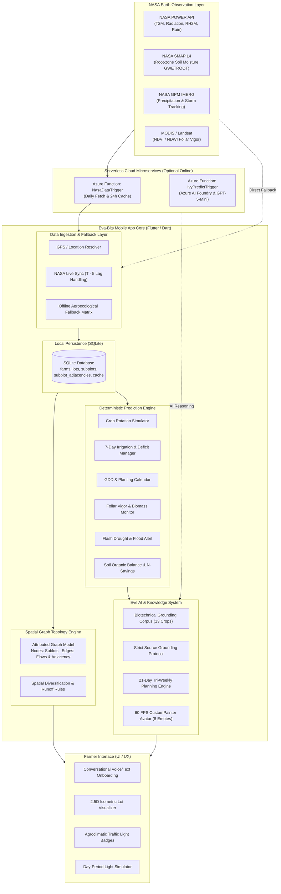
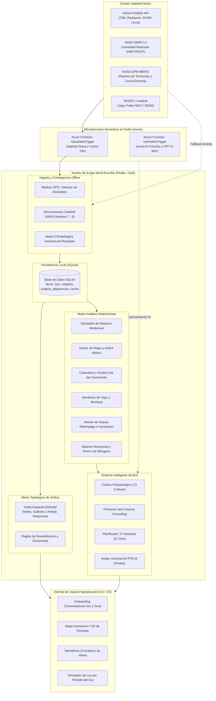

# Eva-Bits: Precision Agroecological Adaptation Platform

**NASA Space Apps Challenge 2026**  
**Selected Challenge:** Field Shift: Adapting Farms with NASA Data  
**Project Development Dates:** November 14 - 15, 2026  

---

## Team Members
* Camila Navarro (Camila Javiera Navarro Centeno)
* Jaslyn West (Jaslyn Amelia West Chavarría)
* Francis Solórzano (Francis Alejandra Solórzano Morales)
* Ninive Sanarrucia (Ninive Cristal Sanarrucia Sánchez)
* Virginia Molina (Virginia Carolina Molina Carrero)

## Project Documentation and Presentation
* **Google Drive Repository (Docs and 7-Slide Presentation):**  
  [Access Project Google Drive](https://drive.google.com/drive/folders/1S3htBqwDd-HKO9yEJdVD-7W1Zf5zoD50?usp=share_link)  
  *Contains the official 7-slide hackathon presentation and the 38-page comprehensive research monograph (`Eva-Bits.pdf` / `Eva-Bits-Spanish.pdf`).*

---

## Language Navigation / Navegacion de Idioma
* [English Version](#english-version)
* [Version en Espanol](#version-en-espanol)

---

<a name="english-version"></a>
# English Version

## 1. Executive Summary and Purpose

Global agricultural production faces an acute sustainability crisis driven by climate change. Increased occurrences of severe droughts, torrential precipitation, heat waves, and pest outbreaks place smallholder livelihoods and food security at severe risk. Projections by NASA and climate models indicate that under high greenhouse gas emission scenarios, yields of fundamental crops such as maize could drop by up to 24% by 2030, while compound climate events (co-occurring heat waves and droughts) increase the risk of simultaneous harvest failure from 29% to 57%.

Small and medium-sized farmers in developing regions (such as Central America and the Dry Corridor of Nicaragua) face severe structural barriers:
* High capital costs of physical hardware (IoT ground sensors, automated weather stations).
* Intermittent or nonexistent cellular and internet connectivity in rural fields.
* Technical complexity of raw scientific data, which is rarely actionable for family farmers.

**Eva-Bits** was created to democratize precision agriculture and agroecological planning. The platform eliminates the need for expensive physical ground sensors by ingesting open-access satellite earth observations from NASA missions (POWER, SMAP, GPM, GRACE, Landsat, and MODIS). Through a deterministic biophysical analytical engine, spatial graph modeling, and an offline-first mobile architecture, Eva-Bits delivers actionable recommendations directly to smallholders. The entire user experience is guided by **Eve**, an empathetic virtual agronomist and phytopathologist companion represented by an interactive, animated vector character.

---

## 2. System Architecture

Eva-Bits uses a decoupled, three-tier architecture optimized for field resilience, zero-cost farmer deployment, and high computational efficiency.



### Architectural Highlights
1. **Decoupled Offline-First Paradigm:** The mobile core operates completely independently of network availability. When internet access is present, the app queries live NASA endpoints (or the lightweight Azure Functions caching layer). In disconnected rural fields, the app automatically transitions to local SQLite caching and historical agroecological baselines without interruptions.
2. **Strict Source Grounding:** Artificial Intelligence models (such as `gpt-5-mini` hosted on Azure AI Foundry) are not permitted to invent numerical predictions. Every numeric output (water deficit, degree days, nitrogen balance) is calculated deterministically by local algorithms, and Eve synthesizes these results while explicitly citing verified scientific literature.
3. **Zero-Emoji User Interface:** In compliance with agricultural software standards and screen reader accessibility, all interface cues use standard system vector icons (`Material Icons` / `CupertinoIcons`) rather than decorative emojis.

---

## 3. NASA Satellite Data Ingestion and Technical Variables

Eva-Bits integrates open-access satellite earth observations through the NASA POWER agroclimatology API (`/api/temporal/daily/point`) with the community parameter set to `community=AG`, supplemented by SMAP and GPM products.

| Parameter Key | Satellite Mission | Physical Dimension | Agronomic Function |
| :--- | :--- | :--- | :--- |
| `T2M` / `T2M_MAX` / `T2M_MIN` | NASA POWER / MERRA-2 | Degrees Celsius (deg C) | Calculation of daily thermal accumulation (GDD), detection of frost risks, and heat wave thresholds. |
| `PRECTOTCORR` | NASA POWER / GPM IMERG | Millimeters per day (mm/day) | Measurement of real 7-day cumulative rainfall and basis for dynamic hydrological balances. |
| `ALLSKY_SFC_SW_DWN` | NASA POWER / CERES | Megajoules per square meter (MJ/m2/day) or kWh/m2 | Estimation of potential photosynthesis and computation of reference evapotranspiration (ET0). |
| `RH2M` | NASA POWER | Percentage (%) | Ambient vapor pressure deficit tracking and fungal pathogen risk calculation. |
| `GWETROOT` | NASA SMAP L4 | Normalized Index (0.0 to 1.0) | Real volumetric water availability in the crop root zone (0.0 = severe drought, 1.0 = water saturation). |
| `GWETTOP` | NASA SMAP L4 | Normalized Index (0.0 to 1.0) | Topsoil moisture (0-5 cm) for seedbed moisture verification and germination window evaluation. |

### Satellite Lag and Temporal Aggregation
Daily NASA POWER products have a processing latency of 3 to 5 days. Eva-Bits handles this systematically:
* The query pipeline automatically computes a moving 7-day retrospective window terminating at $T - 5$ days.
* The system computes moving averages for temperature, solar irradiance, and root-zone moisture, alongside cumulative 7-day precipitation totals.
* If a network timeout exceeds 10 seconds, the offline fallback engages automatically, serving validated historical climate baselines for the farm's municipality (e.g., Dry Corridor vs. Humid Tropics).

---

## 4. Multi-Level Data Fusion Framework

Data convergence follows a structured three-tier data fusion model:

1. **Low-Level Fusion (Raw Telemetry and Declared Inputs):**
   * Ingests GPS coordinates, user parcel declarations, soil taxonomy, and raw time-series feeds from NASA POWER, SMAP, and GPM.
   * Produces a unified, timestamped agroclimatic matrix indexed to the farm's geographical centroid.
2. **Mid-Level Fusion (Physical Variables and Feature Extraction):**
   * Combines physical indicators: root-zone moisture deficit, daily evapotranspiration ($ET_a$), thermal sums ($GDD$), and topologic graph adjacency.
   * Derives intermediate diagnostic indicators: water stress indices, phenological stage markers, and neighborhood vulnerability scores.
3. **High-Level Fusion (Decision-Making and Advisory Synthesis):**
   * Merges physical indices with the biotechnical fitopathological knowledge base (covering 13 regional crops).
   * Generates millimetric irrigation prescriptions, optimal planting schedules, pest warning bulletins, and conversational summaries delivered by Eve.

---

## 5. The 6 Deterministic Agroclimatic Prediction Engines

To maintain absolute scientific reliability and eliminate hallucinations, analytical predictions are executed by deterministic algorithms in `lib/services/agro_prediction_engine.dart`:

### 1. Multi-Year Crop Rotation Simulator
* **Objective:** Establish the optimal sequence of crops for 1 to 3 upcoming seasons to restore soil fertility and disrupt pathogen life cycles.
* **Logic:** Evaluates prior crop extraction history. If an intensive cereal was planted (maize, sorghum), the engine penalizes high-nitrogen demand crops and prioritizes legumes (common bean, cowpea) or green manures (crotalaria, canavalia) to encourage biological nitrogen fixation ($Rhizobium$).
* **Output:** An Agroecological Compatibility Index (0% to 100%) with estimated savings in synthetic urea.

### 2. 7-Day Dynamic Irrigation and Water Deficit Manager
* **Objective:** Predict the exact timing and water depth needed to avoid drought stress without runoff waste.
* **Logic:** Daily water balance: $\Delta S = \text{Precipitation} - ET_a$, where $ET_a$ is derived from solar radiation, air temperature, and relative humidity. Cross-referenced with SMAP `GWETROOT` and soil texture wilting points.
* **Output:** Metric countdown of "Days to Wilting Point" and recommended irrigation volume in millimeters.

### 3. Agricultural Calendar and Growing Degree Days (GDD)
* **Objective:** Determine optimal planting dates and forecast critical physiological stages (flowering, maturity).
* **Logic:** Accumulates daily thermal units:
  $$GDD = \max\left(0, \frac{T_{\max} + T_{\min}}{2} - T_{\text{base}}\right)$$
  Requires at least 3 consecutive days with topsoil moisture $\ge 0.45$ and zero frost probability within 15 days.
* **Output:** Verified planting window and advance warnings if flowering coincides with statistical heat wave periods.

### 4. Crop Health and Vegetative Vigor Monitoring
* **Objective:** Track canopy biomass and detect anomalies relative to zonal historical norms.
* **Logic:** Evaluates normalized vegetation indices (NDVI proxy) against regional climatology curves.
* **Output:** Vegetative health traffic light (Optimal, Moderate, Depressed) and relative yield projection (e.g., 88-94% of zonal capacity).

### 5. Early Warning for Flash Droughts and Waterlogging
* **Objective:** Detect rapid-onset hydroclimatic extremes 3 to 10 days in advance.
* **Logic:** Identifies flash droughts via steep rate-of-loss in root moisture combined with extreme evaporative demand. Identifies waterlogging and root asphyxiation when torrential rain ($> 50\text{ mm/day}$) hits saturated soil (`GWETROOT` $> 0.85$).
* **Output:** High-priority mitigation directives (e.g., drainage channel construction or protective mulching).

### 6. Soil Nutritional Balance and Regeneration Score
* **Objective:** Quantify the long-term impact of farm practices on topsoil vitality.
* **Logic:** Balances nutrient extraction against biomass return, biological nitrogen fixation (40 to 120 kg N/ha for legumes), and slope erosion hazards.
* **Output:** Soil Health Score (0 to 100 points) and monetary savings estimate on synthetic nitrogen inputs.

---

## 6. Spatial Graph Topology Modeling

Traditional agricultural systems treat plots as disconnected entities. Eva-Bits models internal farm divisions as an **Attributed Spatial Graph** ($G = (V, E)$), implemented in `lib/services/subplot_graph_service.dart` and backed by SQLite relational tables:

```
                  [ Sublot 1A: Maize ]
                     (High Ridge)
                           │
                           │ downhill_flow (Runoff & Sediment)
                           ▼
                  [ Sublot 1B: Bean ]
                   (Middle Terraces)
                           │
                           │ buffer_protected (Living Fence / Windbreak)
                           ▼
                  [ Sublot 1C: Coffee ]
                     (Low Valley)
```

### Graph Components
* **Nodes ($V_i$ - Subplots):** Minimum management units holding surface area, current crop, previous crop, soil texture (Sandy, Silty, Clayey, Loamy), elevation, and localized moisture.
* **Edges ($E_{ij}$ - Ecological Relationships):**
  1. `neighbor`: Territorial adjacency. Enforces spatial diversification rules (e.g., prohibiting contiguous sublots from cultivating the same botanical family during the same season).
  2. `downhill_flow`: Directed hydrological relationship based on relative topographic elevation. Directs runoff management, erosion prevention, and pesticide leach monitoring.
  3. `buffer_protected`: Denotes vegetative windbreaks or buffer strips. Mitigates wind speed, arrests chemical drift, and blocks terrestrial insect migration.

Graph queries execute via in-memory adjacency lists in less than 5 milliseconds.

---

## 7. Eve: Virtual Agroecological Assistant and 8-Emote Avatar

### Strict Source Grounding
Eve translates complex satellite matrices and biotechnical research into actionable advice for rural producers without hallucinations. Eve explicitly grounds every recommendation in scientific literature:
* **Satellite Sources:** NASA POWER, SMAP, GPM IMERG, GRACE, Landsat, and MODIS.
* **Soil Taxonomy:** Alliance of Bioversity International and CIAT (2026) soil classifications.
* **Phytopathological Literature:** Peer-reviewed sources covering 13 high-impact crops (maize, common bean, coffee, melon, pineapple, watermelon, apple, orange/citrus, sugarcane, wheat, rice, banana/plantain, and soybean).

### Operational Horizons
* **21-Day Tri-Weekly Planning:**
  * *Week 1 (Days 1-7):* Immediate moisture correction and active pest suppression.
  * *Week 2 (Days 8-14):* GDD tracking, rainfall monitoring, and mid-cycle evaluation.
  * *Week 3 (Days 15-21):* Soil replenishment, organic fertilization, and harvest/rotation preparation.
* **7-Day Change Evolution Checkpoints:** Automated comparison between baseline satellite telemetry and current status after one week.

### Precision Irrigation Recommendations
Eve maps soil texture to recommended irrigation technologies:
1. *High-Frequency Pulse Drip:* 92-95% efficiency, ideal for Sandy and Loamy soils to avoid nutrient leaching.
2. *Low-Pressure Micro-Sprinkler with Mulch:* 85-88% efficiency, ideal for Silty soils and sloped terrains.
3. *Low-Flow Intermittent Drip with Drainage Channels:* 90% efficiency, ideal for Clayey soils to prevent root asphyxiation.
4. *Satellite-Guided Alternate Furrow Irrigation:* 75-80% efficiency, low-cost option for Loamy soils reducing water use by 35%.

### Animated Vector Avatar (60 FPS CustomPainter)
Eve is visually embodied as an animated mascot drawn using pure Flutter vector paths (`_EveCowPainter`). Eve displays 8 distinct operational emotes:
1. `greeting`: Welcomes the farmer and initiates onboarding.
2. `alert`: Pulsing exclamation mark indicating urgent pest, drought, or flood hazards.
3. `sad`: Posture reflecting critical soil moisture depletion or degraded soil balance.
4. `surprised`: Highlights significant 7-day evolution shifts or "What-If" simulator findings.
5. `happy`: Optimal soil moisture, open planting windows, and high soil health scores.
6. `thumbsUp`: High crop rotation compatibility ($>= 80\%$) and confirmed fertilizer savings.
7. `thumbsDown`: Discouraged monoculture sequences or contiguous disease host pairings.
8. `pointing`: Directional gesture guiding the user toward interactive UI controls.

*Settings Visibility Toggle:* Users can toggle between **Show Eve** and **Hide Eve** in `SettingsScreen` to choose between guided visual assistance or a minimalist, data-only display.

---

## 8. Adaptive Onboarding and Conversational Intake

To ensure genuine adoption among smallholders with varying digital literacy:
* **Conversational Natural Language Channel:** Accepts unformatted voice audio or text descriptions. An entity extraction pipeline parses farm names, municipal regions, acreage, and crops into a structured JSON schema.
* **Vernacular Unit Normalization:** Automatically standardizes local measurement units to standard metrics:
  * Manzana ($mz$) = 0.704 hectares.
  * Tarea = 0.0628 hectares.
  * Acre ($ac$) = 0.4047 hectares.
  * Square Meters ($m^2$) = 0.0001 hectares.
* **Quick Start Bypass:** A 1-click option allowing farmers to register their property as a single unified management lot, skipping manual subdivision steps.

---

## 9. Technology Stack

* **Mobile Framework:** Flutter 3.x (Dart 3.x) targeting Android and iOS.
* **Local Database:** SQLite via `sqflite` with foreign key enforcement and transactional integrity.
* **Location Services:** `geolocator` with centroid fallbacks for agricultural departments.
* **Serverless Backend:** Azure Functions (Python 3.10+) with RESTful JSON endpoints.
* **Cloud AI Foundry:** Azure AI Foundry Studio (`gpt-5-mini` / `GPT-4o`).
* **External APIs:** NASA POWER Agroclimatology REST API, NASA SMAP L4, NASA GPM IMERG.

---

## 10. Repository File Structure

```
Eva-bits/
├── .github/                     # CI/CD and repository workflows
├── android/                     # Android native project files
├── assets/                      # Vector illustrations and static assets
│   └── emotes/                  # Emote references and icons
├── azure_functions/             # Serverless backend microservices
│   ├── NasaDataTrigger/         # Daily NASA data ingestion and caching function
│   ├── host.json                # Azure Functions configuration
│   ├── local.settings.json.example # Local environment template
│   ├── requirements.txt         # Python dependencies
│   └── README.md                # Azure Functions deployment documentation
├── docs/                        # Technical specifications and matrices
│   ├── FEATURE_CONVERSATIONAL_ONBOARDING.md # Onboarding specification
│   └── MATRIZ_PREDICCIONES_NASA.md         # Comprehensive NASA parameter matrix
├── features/                    # Core functional specification documents
│   ├── 01_INTEGRACION_DATOS_NASA.md        # NASA satellite integration
│   ├── 02_MOTOR_PREDICCIONES_AGROCLIMATICAS.md # Prediction engine rules
│   ├── 03_TOPOLOGIA_GRAFO_SUBLOTES.md      # Spatial graph modeling
│   ├── 04_ORQUESTACION_IA_IVY.md           # Eve AI orchestration
│   ├── 05_ESTRATEGIA_Y_ANIMACION_EVE.md    # Eve animation and 8 emotes
│   └── SPRINT_PLAN_3_HORAS.md              # Rapid prototype execution plan
├── ios/                         # iOS native project files
├── lib/                         # Flutter application source code
│   ├── constants/               # Colors, soil types, crop types, locations
│   ├── database/                # SQLite DatabaseManager and schema migrations
│   ├── languages/               # Bilingual localization (English and Spanish)
│   ├── screens/                 # Mobile views (Dashboard, Predictions, Map, Setup)
│   ├── services/                # NASA service, Prediction engine, Graph service, AI
│   ├── widgets/                 # EveAnimatedAvatar, Navigation bar, Pickers
│   └── main.dart                # Application entry point and theme setup
├── pubspec.yaml                 # Flutter package configuration and dependencies
└── README.md                    # Project master documentation (Bilingual)
```

---

## 11. Getting Started and Local Setup

### Mobile Application (Flutter)
1. Ensure the Flutter SDK (>= 3.12.2) and Dart are installed.
2. Clone the repository and install dependencies:
   ```bash
   git clone https://github.com/Camijavi/Eva-bits.git
   cd Eva-bits
   flutter pub get
   ```
3. Run the application on an emulator or physical device:
   ```bash
   flutter run
   ```

### Serverless Microservices (Azure Functions)
1. Navigate to the functions directory:
   ```bash
   cd azure_functions
   cp local.settings.json.example local.settings.json
   pip install -r requirements.txt
   ```
2. Start the local serverless host:
   ```bash
   func start
   ```

---

## 12. Scientific and Bibliographic References

* Alliance of Bioversity International - CIAT. (2026). *Complete guide on all soil types*.
* Basak, S., Mandal, S., Dhar, A., & Dey, S. (2025). *Crop Rotation as a Climate-Smart Practice: Maximizing Productivity and Sustainability*. ResearchGate.
* Campos Hernandez, & Lugo Alonso. (2012). *Manual of pests and diseases in sugarcane for the state of Morelos*.
* Deiss. (2025). *Pests and diseases of banana and plantain crops*.
* Delgado Martorell, S. (2024). *The main pests affecting orange cultivation*. PRISMAB.
* Doorenbos, J., et al. (1992). *Crop water requirements*. Food and Agriculture Organization of the United Nations (FAO).
* Dubon, R. (2006). *Main pests of melon cultivation and their natural enemies*.
* FAO. (2000). *Effects of adverse weather phenomena on food production and trade*. LARC-26.
* Gray, E. (2021). *A NASA study predicts impacts of global climate change on crops in 10 years*. NASA GISS.
* Jimenez Martinez, E. (2016). *Technical guide on the preparation and use of biopesticides*. Universidad Nacional Agraria, Nicaragua.
* Monge Munoz, H. (2018). *Pests and diseases in pineapple cultivation*. CICA, Universidad de Costa Rica.
* Murray, M., & Aiston. (2012). *Pests and diseases of the apple tree*. Utah State University Extension.
* NASA. (2009). *Climate and Earth's Energy Budget*. NASA Earth Observatory.
* NASA. (2022). *Series of extreme weather events will increase risks for corn crops and society*. NASA Science.
* NASA. (2024). *The effects of climate change*. NASA Science.
* NASA. (2026). *Global Precipitation During July to September of the 2026-27 El Nino*. NASA GPM.
* NASA Earthdata. (2015). *Soil Moisture Active Passive (SMAP) Mission Description*.
* Porres, & Cuxil. (2024). *Main coffee pests: Detailed guide*. Cambiagro.
* Tran, L., & NASA Goddard Space Flight Center. (2021). *Shoring up the Corn Belt's Soil Health*. NASA Science.
* Vilela, M. (2026). *Pests and diseases in corn cultivation*. IDEMA Institute.
* Voiland, A. (2025). *How to Rotate Crops*. NASA Earth Observatory.

---

<br><br>

---

<a name="version-en-espanol"></a>
# Version en Espanol

## 1. Resumen Ejecutivo y Proposito del Proyecto

La produccion agricola mundial enfrenta una crisis de sostenibilidad sin precedentes provocada por el cambio climatico. El incremento en la frecuencia e intensidad de sequias severas, precipitaciones torrenciales, olas de calor y plagas pone en riesgo directo el sustento de millones de pequenos productores y la seguridad alimentaria global. Estudios de la NASA advierten que, bajo escenarios de altas emisiones de gases de efecto invernadero, el rendimiento de cultivos basicos como el maiz podria descender hasta un 24% para el ano 2030, mientras que los eventos climaticos compuestos (sequias y olas de calor simultaneas) elevan el riesgo de perdidas simultaneas de cosecha del 29% al 57%.

En regiones en desarrollo, como Centroamerica y el Corredor Seco de Nicaragua, los agricultores enfrentan barreras estructurales:
* Altos costos de inversion en hardware especializado (sensores IoT de suelo, estaciones meteorologicas).
* Conectividad celular escasa o nula en las parcelas rurales.
* Dificultad para interpretar datos cientificos abstractos que no se traducen en acciones practicas.

**Eva-Bits** fue concebido en el marco del **NASA Space Apps Challenge 2026** para el reto *"Field Shift: Adapting Farms with NASA Data"* con el fin de democratizar la agricultura de precision y la planificacion agroecologica. La plataforma elimina la necesidad de sensores fisicos en el campo mediante la reutilizacion de datos satelitales abiertos de la NASA (misiones POWER, SMAP, GPM, GRACE, Landsat y MODIS). Mediante un motor biofisico determinista, modelado topologico de grafos y una arquitectura movil Offline-First, Eva-Bits entrega decisiones practicas al agricultor, guiado por **Eve**, una agronoma y fitopatologa virtual representada por una vaquita animada interactiva.

---

## 2. Arquitectura del Sistema

Eva-Bits implementa una arquitectura desacoplada en tres estratos, disenada para ofrecer resiliencia rural, costo cero en sensores y alta velocidad de procesamiento.



### Principios Fundamentales de Diseno
1. **Diseno Desacoplado Offline-First:** La aplicacion funciona con total autonomia sin requerir conexion a internet en el campo. Si existe conexion, consulta las APIs de la NASA o la capa de microservicios en Azure. Si se pierde la conectividad, recurre de inmediato a SQLite y perfiles climatologicos historicos sin bloquear la interfaz.
2. **Fundamento Cientifico Estricto (Strict Source Grounding):** Los modelos de lenguaje como `gpt-5-mini` no inventan formulas ni cifras numericas. Todos los calculos hidricos, termicos y nutricionales son generados localmente por algoritmos deterministas. Eve sintetiza estos resultados respaldandolos con citas bibliograficas verificadas.
3. **Ausencia Total de Emojis:** Para garantizar maxima legibilidad, evitar distracciones en el entorno rural y permitir compatibilidad absoluta con motores de lectura de pantalla y sintesis de voz (Text-to-Speech), toda la interfaz utiliza exclusivamente iconografia vectorial del sistema (`Material Icons` / `CupertinoIcons`).

---

## 3. Ingesta de Datos Satelitales NASA y Variables Tecnicas

Eva-Bits consulta el endpoint publico de agroclimatologia de la NASA (`https://power.larc.nasa.gov/api/temporal/daily/point`) con el parametro comunitario `community=AG`, integrando tambien observaciones de SMAP y GPM.

| Variable Tecnica | Mision Satelital | Unidad de Medida | Utilidad Agroecologica |
| :--- | :--- | :--- | :--- |
| `T2M` / `T2M_MAX` / `T2M_MIN` | NASA POWER / MERRA-2 | Grados Celsius (grados C) | Computo de acumulacion termica fenologica (GDD), alertas de heladas y deteccion de golpes de calor. |
| `PRECTOTCORR` | NASA POWER / GPM IMERG | Milimetros por dia (mm/dia) | Registro de lluvia acumulada en 7 dias y base para balances hidricos dinamicos. |
| `ALLSKY_SFC_SW_DWN` | NASA POWER / CERES | Megajulios por metro cuadrado (MJ/m2/dia) o kWh/m2 | Estimacion de fotosintesis potencial y calculo de evapotranspiracion de referencia (ET0). |
| `RH2M` | NASA POWER | Porcentaje (%) | Evaluacion de presion de vapor ambiental y condiciones predisponentes a hongos foliares. |
| `GWETROOT` | NASA SMAP L4 | Indice normalizado (0.0 a 1.0) | Disponibilidad real de agua en la zona radicular (0.0 = sequia extrema, 1.0 = saturacion total). |
| `GWETTOP` | NASA SMAP L4 | Indice normalizado (0.0 a 1.0) | Humedad en la capa superficial (0-5 cm) para determinar la viabilidad de germinacion en la siembra. |

### Gestion de Ventana Temporal (Desfase Satelital)
Los productos diarios de NASA POWER tienen un desfase habitual de 3 a 5 dias. Eva-Bits solventa este comportamiento:
* Calcula de forma automatica una ventana de 7 dias retrospectivos finalizando en $T - 5$ dias.
* Extrae promedios moviles representativos de temperatura, radiacion y humedad radicular, asi como el total acumulado de precipitacion.
* Ante tiempos de espera superiores a 10 segundos o falta de senal, activa el perfil climatologico de referencia del municipio (ej. Corredor Seco vs. Tropico Humedo de Nicaragua).

---

## 4. Estrategia de Fusión Multinivel de Datos

La plataforma unifica fuentes heterogeneas mediante tres niveles de fusion:

1. **Fusion de Bajo Nivel (Datos Crudos):**
   * Coordenadas GPS del predio, telemetria satelital de la NASA (POWER, SMAP, GPM) y datos registrados por el productor.
   * Genera una matriz unificada y normalizada de series de tiempo geolocalizadas.
2. **Fusion de Nivel Medio (Variables Fisicas e Indices):**
   * Cruza humedad de raiz, balance evapotranspirativo ($ET_a$), suma termica ($GDD$) y topologia de vecindad de parcelas.
   * Deriva el indice de deficit hidrico, la etapa fenologica del cultivo y la matriz de vulnerabilidad fitosanitaria espacial.
3. **Fusion de Alto Nivel (Toma de Decisiones):**
   * Sintesis de indices fisicos junto con la base de conocimientos edafologicos y fitopatologicos para 13 cultivos de alto impacto.
   * Genera recomendaciones de riego en milimetros, ventanas de siembra optimas, alertas de mitigacion y el reporte conversacional de Eve.

---

## 5. Las 6 Predicciones Agroclimaticas Deterministas

El nucleo analitico de `lib/services/agro_prediction_engine.dart` resuelve 6 problematicas fundamentales:

### 1. Simulador de Rotacion Multianual de Cultivos
* **Objetivo:** Definir la sucesion optima de siembras para 1 a 3 ciclos, restableciendo la fertilidad del suelo y cortando plagas.
* **Logica:** Si el ciclo previo fue un cereal extractor (maiz, sorgo) y la humedad radicular es moderada, penaliza cultivos de alta demanda de nitrogeno y prioriza leguminosas (frijol comun, gandul, soya) o abonos verdes para fijar nitrogeno atmosferico ($Rhizobium$).
* **Salida:** Indice de Compatibilidad Agroecologica (0% a 100%) y calculo de ahorro en fertilizante sintetico.

### 2. Gestor de Riego y Deficit Hidrico (Ventana de 7 Dias)
* **Objetivo:** Calcular el momento oportuno y la lamina exacta de agua para evitar marchitamiento sin sobrehumedecer.
* **Logica:** Balance hidrico: $\Delta S = \text{Precipitacion} - ET_a$. Si la humedad desciende del umbral de marchitez permanente segun la textura del suelo, emite alerta urgente.
* **Salida:** Cuenta regresiva de "Dias hasta estres hidrico" y recomendacion de riego en milimetros ($mm$).

### 3. Calendario Agricola y Grados-Dia de Crecimiento (GDD)
* **Objetivo:** Determinar la fecha de siembra ideal y proyectar los hitos fenologicos de floracion y cosecha.
* **Logica:** Integracion termica diaria:
  $$GDD = \max\left(0, \frac{T_{\max} + T_{\min}}{2} - T_{\text{base}}\right)$$
  Requiere al menos 3 dias continuos con humedad superficial $\ge 0.45$ y sin riesgo de heladas en los siguientes 15 dias.
* **Salida:** Fechas de inicio de siembra y advertencia si la floracion coincidira con periodos estadisticos de canicula o golpes de calor.

### 4. Monitoreo de Salud y Vigor Vegetativo
* **Objetivo:** Evaluar la acumulacion de biomasa y detectar anomalias frente a la curva media historica zonal.
* **Logica:** Compara anomalias del indice de vegetacion (proxy NDVI / MODIS).
* **Salida:** Semaforo de vigor foliar (Optimo, Normal, Deprimido) y proyeccion de rendimiento relativo respecto al potencial maximo de la region.

### 5. Alerta Temprana de Sequias Relampago e Inundaciones
* **Objetivo:** Anticipar desastres hidroclimaticos con 3 a 10 dias de margen operativo.
* **Logica:** Identifica sequias relampago (*Flash Drought*) ante descensos abruptos de humedad radicular combinados con alta demanda evaporativa. Identifica asfixia radicular cuando precipitaciones torrenciales ($> 50\text{ mm/dia}$) impactan suelo saturado (`GWETROOT` $> 0.85$).
* **Salida:** Protocolos inmediatos de mitigacion (apertura de drenajes o aplicacion de acolchado protector).

### 6. Balance Nutricional y Regeneracion de Suelo
* **Objetivo:** Cuantificar la recuperacion de materia organica y fertilidad en el perfil arable.
* **Logica:** Modela la extraccion de cosechas frente al aporte de biomasa y fijacion biologica de nitrogeno (40 a 120 kg N/ha en leguminosas), considerando la pendiente topografica.
* **Salida:** Puntuacion de Salud del Suelo (0 a 100 puntos) y ahorro economico proyectado en insumos quimicos.

---

## 6. Modelado Espacial mediante Topologia de Grafos

Superando la vision aislada de parcelas, Eva-Bits modela la finca como un **Grafo Espacial Atribuido** ($G = (V, E)$), implementado en `lib/services/subplot_graph_service.dart` y almacenado en SQLite:

```
                  [ Sublote 1A: Maiz ]
                     (Ladera Alta)
                           │
                           │ downhill_flow (Escorrentia y Sedimentos)
                           ▼
                  [ Sublote 1B: Frijol ]
                    (Terrazas Medias)
                           │
                           │ buffer_protected (Cerca Viva / Barrera)
                           ▼
                  [ Sublote 1C: Cafe ]
                     (Valle Bajo)
```

### Componentes del Grafo
* **Nodos ($V_i$ - Sublotes):** Unidades minimas de manejo que almacenan superficie, cultivo actual, cultivo previo, tipo de suelo (Arenoso, Limoso, Arcilloso, Franco segun Alianza Bioversity-CIAT), elevacion y humedad radicular.
* **Aristas ($E_{ij}$ - Relaciones Ecologicas):**
  1. `neighbor`: Lindero territorial directo. Aplica algoritmos de siembra en mosaico para evitar monocultivos continuos de la misma familia botanica.
  2. `downhill_flow`: Grafo dirigido por pendiente topografica. Modela la escorrentia natural, previniendo lavado de nutrientes y acumulacion de lixiviados en zonas bajas.
  3. `buffer_protected`: Cerca viva o franja forestal protectora. Mitiga vientos desecantes, frena la deriva de quimicos y detiene el avance de plagas terrestres.

Los recorridos del grafo se ejecutan en memoria en menos de 5 milisegundos mediante busquedas en anchura y profundidad.

---

## 7. Eve: Asistente Agroecologica Virtual y Avatar Vectorial de 8 Emotes

### Fundamento Cientifico y Citacion Rigurosa (Strict Source Grounding)
Eve traduce telemetria compleja en consejos practicos y empaticos para el agricultor, respaldando cada declaracion en fuentes oficiales:
* **Fuentes Satelitales (NASA):** POWER, SMAP, GPM IMERG, GRACE, Landsat y MODIS.
* **Edafologia:** Clasificacion de texturas de suelo de la Alianza Bioversity International y CIAT (2026).
* **Corpus Fitopatologico:** Estudios agronomicos para 13 cultivos fundamentales (maiz, frijol, cafe, melon, pina, sandia, manzana, naranja/citricos, cana de azucar, trigo, arroz, banano/platano y soya).

### Horizontes de Planificacion Operativa
* **Proyecciones Tri-Semanales (21 Dias):**
  * *Semana 1 (Dias 1 a 7):* Correccion inmediata del deficit de agua y control preventivo de plagas.
  * *Semana 2 (Dias 8 a 14):* Seguimiento termico GDD, monitoreo de lluvias GPM y balance intermedio.
  * *Semana 3 (Dias 15 a 21):* Regeneracion edafica, aplicacion de abonos organicos y preparacion de siembra/cosecha.
* **Punto de Control Semanal (+7 Dias):** Evaluacion automatica de la evolucion climatica transcurrida una semana respecto a la linea base.

### Guias de Sistemas de Riego de Precision por Suelo
Eve asigna la tecnologia de riego segun la textura edafica:
1. *Goteo por Pulsos de Alta Frecuencia:* Eficiencia 92-95%, recomendado para suelo Arenoso y Franco, previniendo lixiviacion.
2. *Microaspersion con Acolchado (Mulch):* Eficiencia 85-88%, ideal para suelo Limoso y laderas, evitando compactacion por impacto.
3. *Goteo Intermitente con Zanjas de Evacuacion:* Eficiencia 90%, recomendado para suelo Arcilloso, previniendo encharcamiento y asfixia radicular.
4. *Riego por Surcos Alternos Guiado por Satelite:* Eficiencia 75-80%, alternativa economica para suelo Franco que ahorra un 35% de agua.

### Avatar Vectorial Animado (60 FPS CustomPainter)
Eve esta ilustrada mediante trazos vectoriales puros en Flutter (`_EveCowPainter`), animando a una vaquita con 8 expresiones operativas:
1. `greeting`: Saludo de bienvenida y asistencia inicial.
2. `alert`: Signo de exclamacion vectorial pulsante ante riesgos inminentes de plagas, sequias o tormentas.
3. `sad`: Postura decaida que refleja deficit critico de humedad o suelo empobrecido por monocultivo.
4. `surprised`: Destaca cambios climaticos significativos en la revision semanal o resultados del simulador.
5. `happy`: Expresion de alegria ante humedad optima, ventanas de siembra favorables y salud del suelo superior a 85/100.
6. `thumbsUp`: Medallon vectorial de pulgar arriba en rotaciones de alta compatibilidad ($>= 80\%$) y ahorro de fertilizante.
7. `thumbsDown`: Medallon vectorial de pulgar abajo ante secuencias agronomicas desaconsejadas o peligro de asfixia radicular.
8. `pointing`: Brazo extendido que guia la atencion del productor hacia selectores y controles de la aplicacion.

*Interruptor de Visibilidad en Configuracion:* En `SettingsScreen`, el usuario puede seleccionar **Mostrar a Eve** u **Ocultar a Eve** segun prefiera una compania visual dinamica o una interfaz compacta puramente numerica.

---

## 8. Experiencia de Usuario y Onboarding Conversacional Adaptativo

Para eliminar barreras tecnologicas en comunidades rurales:
* **Canal Conversacional por Voz y Texto:** Permite describir la finca en lenguaje natural y coloquial. Un motor de extraccion de entidades parsea los datos y los normaliza en un esquema JSON estructurado.
* **Normalizacion de Medidas Vernaculas:** Convierte automaticamente unidades regionales de medida a estandares unificados:
  * Manzana ($mz$) = 0.704 hectareas.
  * Tarea = 0.0628 hectareas.
  * Acre ($ac$) = 0.4047 hectareas.
  * Metro cuadrado ($m^2$) = 0.0001 hectareas.
* **Atajo de Inicio Rapido (Bypass):** Permite registrar la finca completa como un unico lote principal con un solo toque, omitiendo divisiones complejas para agricultores que gestionan su predio en bloque.

---

## 9. Pila Tecnologica

* **Frontend Movil:** Flutter 3.x (Dart 3.x) para Android e iOS.
* **Base de Datos Local:** SQLite mediante `sqflite` con claves foraneas activas y control transaccional.
* **Geolocalizacion:** `geolocator` con coordenadas de referencia por departamento y municipio.
* **Backend Serverless:** Azure Functions (Python 3.10+) con arquitectura de microservicios REST.
* **Plataforma de Inteligencia Artificial:** Azure AI Foundry Studio (`gpt-5-mini` / `GPT-4o`).
* **Servicios de Observacion Terrestre:** NASA POWER Agroclimatology API, NASA SMAP L4, NASA GPM IMERG.

---

## 10. Estructura de Directorios del Repositorio

```
Eva-bits/
├── .github/                     # Flujos de trabajo e integracion continua
├── android/                     # Codigo nativo Android
├── assets/                      # Recursos vectoriales y graficos estaticos
│   └── emotes/                  # Iconos y referencias de expresiones
├── azure_functions/             # Microservicios serverless en la nube
│   ├── NasaDataTrigger/         # Ingesta diaria y cache de datos NASA
│   ├── host.json                # Configuracion del entorno Azure Functions
│   ├── local.settings.json.example # Plantilla de variables de entorno locales
│   ├── requirements.txt         # Dependencias Python
│   └── README.md                # Documentacion tecnica de despliegue Azure
├── docs/                        # Especificaciones tecnicas y matrices
│   ├── FEATURE_CONVERSATIONAL_ONBOARDING.md # Especificacion del onboarding
│   └── MATRIZ_PREDICCIONES_NASA.md         # Matriz detallada de parametros NASA
├── features/                    # Documentacion funcional de modulos clave
│   ├── 01_INTEGRACION_DATOS_NASA.md        # Ingesta satelital NASA
│   ├── 02_MOTOR_PREDICCIONES_AGROCLIMATICAS.md # Reglas del motor determinista
│   ├── 03_TOPOLOGIA_GRAFO_SUBLOTES.md      # Modelado topologico de grafos
│   ├── 04_ORQUESTACION_IA_IVY.md           # Orquestacion de Eve con IA
│   ├── 05_ESTRATEGIA_Y_ANIMACION_EVE.md    # Diseno de animacion y 8 emotes
│   └── SPRINT_PLAN_3_HORAS.md              # Cronograma de ejecucion del prototipo
├── ios/                         # Codigo nativo iOS
├── lib/                         # Codigo fuente de la aplicacion Flutter
│   ├── constants/               # Colores, suelos, cultivos y ubicaciones
│   ├── database/                # DatabaseManager SQLite y migraciones
│   ├── languages/               # Localizacion bilingue (Espanol e Ingles)
│   ├── screens/                 # Vistas (Dashboard, Predicciones, Mapas, Fincas)
│   ├── services/                # Servicio NASA, Motor de reglas, Grafos, IA
│   ├── widgets/                 # Avatar animado Eve, Barra de navegacion, Modales
│   └── main.dart                # Punto de entrada y configuracion de temas
├── pubspec.yaml                 # Dependencias y paquetes de Flutter
└── README.md                    # Documentacion maestra del proyecto (Bilingue)
```

---

## 11. Instalacion y Configuracion Local

### Aplicacion Movil (Flutter)
1. Verificar que el SDK de Flutter (>= 3.12.2) y Dart esten instalados en el sistema.
2. Clonar el repositorio e instalar las dependencias necesarias:
   ```bash
   git clone https://github.com/Camijavi/Eva-bits.git
   cd Eva-bits
   flutter pub get
   ```
3. Ejecutar la aplicacion en un emulador o dispositivo fisico:
   ```bash
   flutter run
   ```

### Microservicios Serverless (Azure Functions)
1. Navegar al directorio de funciones:
   ```bash
   cd azure_functions
   cp local.settings.json.example local.settings.json
   pip install -r requirements.txt
   ```
2. Iniciar el host local de Azure Functions:
   ```bash
   func start
   ```

---

## 12. Referencias Cientificas y Bibliograficas

* Alianza Bioversity International - CIAT. (2026). *Guia completa sobre todos los tipos de suelo*.
* Basak, S., Mandal, S., Dhar, A., & Dey, S. (2025). *Crop Rotation as a Climate-Smart Practice: Maximizing Productivity and Sustainability*. ResearchGate.
* Campos Hernandez, & Lugo Alonso. (2012). *Manual de plagas y enfermedades en cana de azucar para el estado de Morelos*.
* Deiss. (2025). *Plagas y enfermedades del cultivo de platano y banano*.
* Delgado Martorell, S. (2024). *Las principales plagas que afectan al cultivo del naranjo*. PRISMAB.
* Doorenbos, J., et al. (1992). *Crop water requirements*. Food and Agriculture Organization of the United Nations (FAO).
* Dubon, R. (2006). *Principales plagas del cultivo de melon y sus enemigos naturales*.
* FAO. (2000). *Efectos de los fenomenos climatologicos adversos en la produccion y el comercio de los alimentos*. LARC-26.
* Gray, E. (2021). *Un estudio de la NASA predice impactos del cambio climatico global en los cultivos en 10 anos*. NASA GISS.
* Jimenez Martinez, E. (2016). *Guia tecnica sobre la preparacion y utilizacion de bioplaguicidas*. Universidad Nacional Agraria, Nicaragua.
* Monge Munoz, H. (2018). *Plagas y enfermedades en el cultivo de pina*. Centro de Investigaciones en Contaminacion Ambiental, Universidad de Costa Rica.
* Murray, M., & Aiston. (2012). *Plagas y enfermedades del manzano*. Utah State University Extension.
* NASA. (2009). *Climate and Earth's Energy Budget*. NASA Earth Observatory.
* NASA. (2022). *Series de eventos meteorologicos extremos aumentaran los riesgos para los cultivos de maiz*. NASA Ciencia.
* NASA. (2024). *Los efectos del cambio climatico*. NASA Ciencia.
* NASA. (2026). *Global Precipitation During July to September of the 2026-27 El Nino*. NASA GPM.
* NASA Earthdata. (2015). *Soil Moisture Active Passive (SMAP) Mission Description*.
* Porres, & Cuxil. (2024). *Principales plagas del cafe: Guia detallada*. Cambiagro.
* Tran, L., & NASA Goddard Space Flight Center. (2021). *Shoring up the Corn Belt's Soil Health*. NASA Science.
* Vilela, M. (2026). *Plagas y enfermedades en el cultivo del maiz*. Instituto IDEMA.
* Voiland, A. (2025). *How to Rotate Crops*. NASA Earth Observatory.
