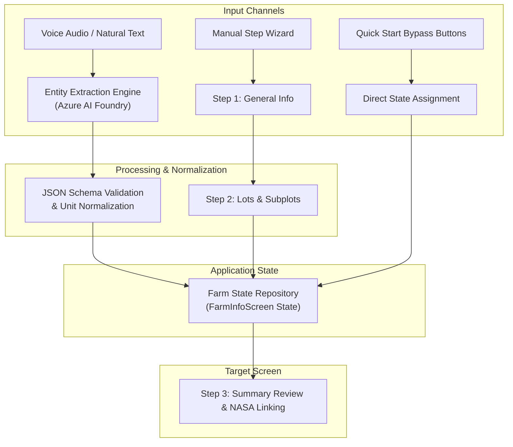

# Functional Specification: Conversational Onboarding & Quick Start Bypass

## 1. Overview and Purpose

The **Conversational Onboarding & Quick Start Bypass** subsystem captures and structures agricultural land data (farm identification, geographic location, total surface area, and hierarchical lots/subplots) with minimal user friction.

The system provides two entry channels:
1. **Conversational Extraction Channel:** Ingests unformatted voice audio or natural language text descriptions and uses an LLM entity extraction pipeline to parse and normalize the input into structured data.
2. **Quick Start Bypass Channel:** Allows users to bypass detailed lot/subplot division by automatically consolidating the user's declared total farm area into a single primary management lot.

---

## 2. System Architecture



---

## 3. Natural Language Entity Extraction Pipeline

### 3.1 Input Ingestion
* **Input Types:** Transcribed voice audio streams or raw text strings.
* **Domain:** Smallholder agricultural descriptions, which frequently combine vernacular measurement units, regional colloquialisms, and implicit lot divisions.

### 3.2 Unit Normalization Rules
Regional and vernacular measurement units are normalized to standard application enumerations:

| Vernacular / Regional Input | Target `SurfaceUnit` Enum | Standardization Factor (to Hectares) |
| :--- | :--- | :--- |
| *Hectárea*, *ha*, *hectares* | `SurfaceUnit.hectares` | $1.0\text{ ha}$ |
| *Acre*, *ac*, *acres* | `SurfaceUnit.acres` | $0.4047\text{ ha}$ |
| *Manzana*, *mz* | `SurfaceUnit.hectares` | $0.704\text{ ha}$ (regional standard) |
| *Tarea*, *tareas* | `SurfaceUnit.tareas` | $0.0628\text{ ha}$ (regional standard) |
| *Metro cuadrado*, *m²* | `SurfaceUnit.squareMeters` | $0.0001\text{ ha}$ |

### 3.3 Geographic Zone Mapping
Mentions of municipal or departmental jurisdictions in Nicaragua (e.g., *Estelí*, *Matagalpa*, *Jinotega*, *León*, *Chinandega*, *Rivas*) are extracted and matched to geographic coordinate centroids used by NASA Earth Observation services (NASA POWER and SMAP).

### 3.4 Extraction Prompt Specification
```text
Task: Parse agricultural descriptions into a structured JSON representation of a farm.

Instructions:
1. Extract 'farm_name'. If not stated, infer a default based on the zone or crop.
2. Extract 'geographic_zone' and map to the nearest recognized administrative zone.
3. Extract 'total_surface' (numerical float) and 'surface_unit'.
4. Identify individual parcels or crops and populate the 'lots' array with 'name', 'surface', and 'current_crop'.
5. Ensure the sum of lot surfaces does not exceed total_surface.
6. Output valid JSON matching the specified schema.
```

---

## 4. JSON Schema Specification

```json
{
  "$schema": "https://json-schema.org/draft/2020-12/schema",
  "title": "FarmProfile",
  "type": "object",
  "required": ["farm_name", "geographic_zone", "total_surface", "surface_unit", "lots"],
  "properties": {
    "farm_name": {
      "type": "string",
      "description": "Identifier or registered name of the farm."
    },
    "geographic_zone": {
      "type": "string",
      "description": "Geographical region or municipality."
    },
    "total_surface": {
      "type": "number",
      "minimum": 0.01,
      "description": "Total surface area of the property."
    },
    "surface_unit": {
      "type": "string",
      "enum": ["hectares", "acres", "squareMeters", "tareas"]
    },
    "lots": {
      "type": "array",
      "items": {
        "type": "object",
        "required": ["name", "surface"],
        "properties": {
          "name": { "type": "string" },
          "surface": { "type": "number", "minimum": 0.01 },
          "current_crop": { "type": "string" },
          "subplots": {
            "type": "array",
            "items": {
              "type": "object",
              "required": ["name", "surface"],
              "properties": {
                "name": { "type": "string" },
                "surface": { "type": "number", "minimum": 0.01 }
              }
            }
          }
        }
      }
    }
  }
}
```

### Sample Instance
```json
{
  "farm_name": "Finca San Pedro",
  "geographic_zone": "Estelí",
  "total_surface": 2.5,
  "surface_unit": "hectares",
  "lots": [
    {
      "name": "Lote 1 - Maíz",
      "surface": 1.5,
      "current_crop": "Maíz",
      "subplots": []
    },
    {
      "name": "Lote 2 - Frijol",
      "surface": 1.0,
      "current_crop": "Frijol",
      "subplots": []
    }
  ]
}
```

---

## 5. Quick Start Bypass Implementation (`_bypassAsSingleLot`)

To eliminate complex manual subdivision overhead for farmers managing their property as a unified block:

* **Trigger:** Action button on Step 1: *"Omitir división (Usar toda la finca como 1 lote)"* (`kQuickStartWholeFarm`).
* **Execution:**
  1. Validates the general farm parameters entered by the user on Step 1 (`_step1FormKey.currentState.validate()`).
  2. Consolidates 100% of the user-entered farm surface into a single primary `LotItem` (`"<Farm Name> - Lote Principal"`).
  3. Sets `_lotsCountController.text` = `"1"`.
  4. Advances the wizard directly to Step 3 (`_currentStep = 2`) for summary review and NASA linking.
* **Latency:** Instantaneous ($< 5\text{ ms}$).

---

## 6. Application State Mapping

| Target State Variable | Source Entity Key / Bypass Mapping | Type |
| :--- | :--- | :--- |
| `_farmNameController.text` | `farm_name` | `String` |
| `_geographicZoneController.text` | `geographic_zone` | `String` |
| `_totalSurfaceController.text` | `total_surface.toString()` | `String` |
| `_selectedUnit` | `surface_unit` (parsed enum) | `SurfaceUnit` |
| `_lots` | `lots[]` | `List<LotItem>` |
| `_currentStep` | `2` (when bypass is triggered) | `int` |
